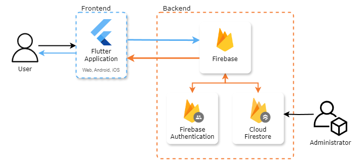

<h1 id="title" align="center">2024-MedicRecall2</h1>

## Contents

- [**2024-MedicRecall2**](#title)
  - [**Project Description**](#project-description)
  - [**Stakeholders**](#stakeholders)
  - [**User Stories**](#user-stories)
  - [**Project Requirements**](#project-requirements)
  - [**Additional Features**](#additional-features)
  - [**User Guide**](#user-guide)
  - [**Developer Guide**](#developer-guide)
    - [**Requirements**](#requirements)
    - [**Build**](#build)
  - [**Tech Stack**](#tech-stack)
  - [**Architecture Diagram**](#architecture-diagram)
  - [**Team Members**](#team-members)
  
## Project Description

This is the third iteration of the study support tool for medical students undergoing the MSRA exams. In this particular iteration, based on previous years’ work, we aim to:

- Implement a quarterly mock system with additional miniature mocks
- Release a working mobile app on both Android and iOS
- Update the UI to meet industry standards
- Develop a virtual study coach
- Improve the overall functionality of the website
- Include a generative AI model to familiarize learners with GMC standards

## Stakeholders

**NHS (National Health Service)**
- **Role:** Public sector entity overseeing healthcare in the UK  
- **Aim:** To ensure well-prepared and competent doctors enter higher training roles  

**Trainee Doctors / Junior Doctors**  
- **Role:** Primary users of the platform  
- **Aim:** To prepare effectively for the Multi-Specialty Recruitment Assessment (MSRA) and improve their chances of securing higher training roles in preferred locations  

**Teachers**  
- **Role:** Supporters in the learning process  
- **Aim:** Ensure students are consistently tested and prepared  

Further information on our stakeholders can be found here:

## User Stories

- **As a Trainee/Junior Doctor**, I want to access a variety of revision resources related to my course and retain the information effectively. I would require an accurate feedback system so that I can understand where I was wrong and how I could improve on my areas of weakness.

- **As a Doctor**, I want to quickly brush up on my knowledge so that I do not forget important concepts. I would prefer brief summaries of information so that I can study on the move or during breaks.

- **As a Teacher**, I want the program to have a scheduled examination system so that my students are constantly tested on their knowledge, ensuring they are learning. I would prefer the questions to differ from the revision assets to prevent complacency in learning.

## Project Requirements

- **Learning Progress Tracking**
  - Implement revision reminders
  - Develop quarterly mini-exams

- **Mobile Application Development**
  - Deploy the existing project as a mobile application for both Android and iOS

- **UI/UX Redesign**  
  - Redesign the user interface to align with industry standards

## Additional Features

If time and resources permit we plan to include:
- **Virtual Study Coach**  
  - Implement a virtual coach similar to Duolingo’s 'Duo' character  
  - **Purpose:** Guide users through their exam preparation period

- **AI-Assisted Learning**  
  - Develop a generative AI model  
  - **Purpose:** Help users learn from GMC professionalism guidelines

- **Interactive Scenarios**  
  - Integrate video-simulated scenario questions  
  - **Purpose:** Enhance practical learning and decision-making skills

## User Guide

The app is being hosted on Google Firebase [here](https://flashcard-6edc2.web.app/#landing)

## Developer Guide

### Requirements

To build MedicRecall yourself, you will need the following tools:
- Android Studio ([Available here](https://developer.android.com/studio/install))
- An emulator capable of running either:
  - Android 6.0 or above, or
  - iOS 11.0 or above
- Flutter SDK version 3.24.3 ([Available here](https://docs.flutter.dev/release/archive))
  - (Running Dart version 3.5.3)
- A clone of the repository via: `git clone https://github.com/spe-uob/2024-MedicRecall2.git` or `git clone git@github.com:spe-uob/2024-MedicRecall2.git`

### Build

1. Navigate to [flashcard](./flashcard) using `cd flashcard/`
2. Run `flutter pub get` to install dependencies
3. To build the app in:
   - Android: run `flutter build apk`
   - iOS: run `flutter build ios --release --no-codesign`
   - macOS: run `flutter create --platforms=macos` followed by `flutter build macos`
   - Web browser: run `flutter build web`
4. Run `flutter run` to start the app on a device or web browser

## Tech Stack

- **Language**: [Dart](https://dart.dev/)
- **Front-End**: [Flutter](https://flutter.dev/)
- **Back-End**: [Firebase](https://firebase.google.com/)
- **Database**: [Cloud Firestore](https://firebase.google.com/docs/firestore)
- **Targeted Platforms**: Browser, Android and iOS

  
Firebase Structure

    

      
    
     

## Architecture Diagram

  

## Team Members

| Member                       | Email                                                 |
| ---------------------------- | ----------------------------------------------------- |
| Clarissa Ch'ng               | [fr22378@bristol.ac.uk](mailto:fr22378@bristol.ac.uk) |
| Elsa Wakfi                   | [xp23980@bristol.ac.uk](mailto:xp23980@bristol.ac.uk) |
| Tinaye Samuel Chibanda       | [ua20351@bristol.ac.uk](mailto:ua20351@bristol.ac.uk) |
| Rowan Watcham                | [no23481@bristol.ac.uk](mailto:no23481@bristol.ac.uk) |
| Dennis Han                   | [jf23616@bristol.ac.uk](mailto:jf23616@bristol.ac.uk) |
| Saud Binlebdah               | [hr22169@bristol.ac.uk](mailto:hr22169@bristol.ac.uk) |

