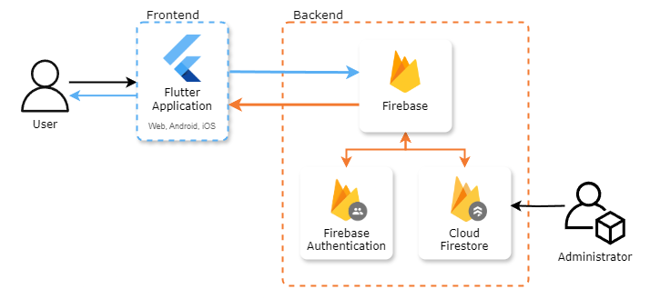
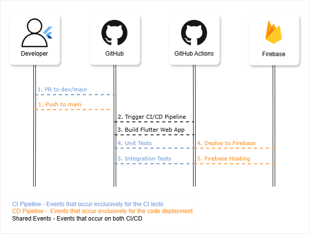

# MedicRecall2 Handover Document

## Contents
- [Project Overview](#project-overview)
- [Repository Details](#repository-details)
- [Installation & Setup](#installation--setup)
- [Architecture Overview](#️-architecture-overview)
- [Project Structure](#project-structure)
- [Testing & Debugging](#️testing)
- [Database Structure](#database-structure)
- [Cloud Functions](#️-cloud-functions)
- [2024/2025 Progress](#20242025-progress)

## 📌 Project Overview <a id = "project-overview"></a>
- **Project Name:** MedicRecall
- **Description:** A cross-platform application built with Flutter, using Firebase for backend services such as authentication, Firestore database, and cloud functions.
- **Tech Stack:**
  - Frontend: Flutter (Dart)
  - Backend: Firebase (Auth, Firestore, Functions, Hosting)
  - CI/CD: GitHub Actions

<p align="right">(<a href="#contents">back to top</a>)</p>

## 📂 Repository Details <a id = "repository-details"></a>
- **🔗 GitHub Repository URL:** [2024-MedicRecall2](https://github.com/spe-uob/2024-MedicRecall2)
- **🛠 Branching Strategy:**
  - `main` → Stable production branch
  - `dev` → Active development branch
- **🔑 Access & Permissions:**
  - Firebase access is managed via Firebase Console (Google Cloud IAM roles required).
<p align="right">(<a href="#contents">back to top</a>)</p>

## 🚀 Installation & Setup <a id = "installation--setup"></a>
This guide will walk you through setting up and running MedicRecall on your local machine.

**🔗 Quick Links**
- [Prerequisites](#prerequisites)
- [Setup Guide](#️setup-guide)

> [!WARNING]
> We highly recommend using the specified Flutter, Dart, and Firebase versions mentioned below. 
> Using different versions may lead to compatibility issues. Additionally, ensure that all dependencies are properly installed before running the application.

### 📌 Prerequisites <a id = "prerequisites"></a>
Before you begin, make sure you have the following installed:
- **Flutter SDK version 3.24.3** ([Flutter Install Guide](https://docs.flutter.dev/release/archive))
  - Running **Dart v3.5.3** ([Dart Install Guide](https://dart.dev/get-dart))
- **Firebase CLI** ([Firebase Setup Guide](https://firebase.google.com/docs/cli))
- **Node.js** (Required for Firebase functions): 
  - macOS: `brew install node`
  - Windows: `choco install nodejs`
- **Chromedriver** (Required for local CI testing): 
  - macOS: `brew install chromedriver`
  - Windows: `choco install chromedriver`
- Android Studio (For mobile development): ([Android Studio Install Guide](https://developer.android.com/studio/install))

> [!NOTE]
> Ensure that Firebase is set up correctly by adding the following files to the appropriate directories:
> - `google-services.json` (Android)
> - `GoogleService-Info.plist` (iOS/macOS)
> Without these files, Firebase-related features will not function properly.


### ⚙️ Setup Guide <a id = "setup-guide"></a>
1. Clone the repository using either HTTPS or SSH:
   ```sh
   git clone https://github.com/spe-uob/2024-MedicRecall2.git #https
   ``` 
   or 
   ```sh
   git clone git@github.com:spe-uob/2024-MedicRecall2.git #ssh
   ```
2. Install dependencies:
  Navigate to the project directory and install dependencies:
   ```sh
   cd flashcard/
   flutter pub get
   ```
3. Build the app:
  Run the appropriate command to build the app for your desired platform:
   - **📱 Android:**
   ```sh 
   flutter build apk
   ```
   - **🍏 iOS:**
   ```sh
   flutter build ios --release --no-codesign
   ```
   - **💻 macOS:**
   ```sh
   flutter create --platforms=macos && flutter build macos
   ```
   - **🌍 Web browser:**
   ```sh
   flutter build web
   ```
4. Run the app:
  To launch the app, run: 
   ```sh
   flutter run
   ```
<p align="right">(<a href="#contents">back to top</a>)</p>

## 🏗️ Architecture Overview
The following diagram illustrates the MedicRecall system architecture, highlighting the interaction between the frontend Flutter application and Firebase backend services.

<p align="left">
  
</p>
<p align="right">(<a href="#contents">back to top</a>)</p>

## 📂 Project Structure <a id = "project-structure"></a>
This section provides an overview of the important files contained within the project structure:
- [Root Directory](#root-directory)
- [./.github](#️github)
- [./flashcard](#flashcard-)

### 🏠 Root Directory <a id = "root-directory"></a>
The root directory contains essential files for **project setup, documentation, and configuration**.
```
2024-MedicRecall2
├── .github/         # GitHub files
├── docs/            # Project documentation
├── flashcard/       # Project code
└── README.md        # General overview
```

### ⚙️ ./.github <a id = "github"></a>
The `.github` directory houses our GitHub configurations, such as **Continuous Integration/ Deployment pipelines, issue templates, and pull request guidelines**.
```
.github/
├── workflows/                       # CI/CD pipelines (GitHub Actions)
│   ├── ci.yml                       # Workflow for testing & building Flutter app
│   └── deploy.yml                   # Deployment pipeline
├── ISSUE_TEMPLATE/                  # GitHub issue templates
│   └── OTHER.md                     # Template for creating issues
└── pull_request_template.md         # Standard PR guidelines
```
**🔧 ./.github/workflows**
This directory contains the workflows required for **GitHub Actions** to run tests and deploy our project. The diagram outlining this can be found [here](#️-cicd-diagram).

**📝 ./.github/ISSUE_TEMPLATE**
This directory contains pre-defined issue templates that help **streamline issue reporting** and ensure consistency in bug reports and feature requests.

To keep things clear, we recommend maintaining two separate templates:
- 🔹 Bug Report Template – For reporting software defects, crashes, or unexpected behavior.
- 🔹 Feature Request Template – For suggesting new enhancements or functionalities.

> **📌 Tip:** Well-defined issue templates improve collaboration by providing maintainers with all necessary details upfront.

📖 More Info: [GitHub Issue Templates Guide](https://docs.github.com/en/communities/using-templates-to-encourage-useful-issues-and-pull-requests/manually-creating-a-single-issue-template-for-your-repository).

### 📱 ./flashcard <a id = "flashcard-"></a>
The `flashcard/` directory contains the **main source code** for the app, which includes the Flutter source code, Firebase functions for the backend, and platform-specific configurations (Android, iOS, and Web).
```
flashcard/
├── integration_test/   # Contains integration tests for the entire app
├── functions/          # Firebase functions backend
├── lib/                # Main Flutter source code
│   ├── main.dart       # App entry point
│   ├── screens/        # UI screens
│   ├── widgets/        # Reusable components
│   └── utils/          # Utility functions
├── test/               # Unit tests
└── pubspec.yaml        # Flutter dependencies
```

**📌 Key Components:**
- ✅ `lib/screens/` – All UI screens and page layouts.
- ✅ `lib/widgets/` – Modular, reusable UI components.
- ✅ `lib/models/` – Data structures and app logic.
- ✅ `lib/services/ `– API requests, Firebase interactions, and authentication handling.
- ✅ `test/` & `integration_test/` – Unit and integration tests for app stability.

> **💡 Best Practice:** Write clean, well-organized, and well-documented code to ensure scalability and maintainability.
>
> <i>📖 We have included comments throughout the code to explain functionality, making it easier to understand and modify when needed.</i>
<p align="right">(<a href="#contents">back to top</a>)</p>

## 🛠️ Testing & Debugging
This section provides an overview to testing in Flutter.  <a id = "testing"></a>
- [Unit & Widget Tests](#unit-tests)
- [Continuous Integration Tests](#continuous-integration)
- [CI/CD Diagram](#️cicd)

### 🔧 Unit & Widget Tests <a id = "unit-tests"></a>
**Unit Tests:** Test individual functions, methods, or classes.

**Widget Tests:** Test individual widgets in isolation.
- [Writing Unit & Widget Tests](#-writing-unit--widget-tests)
- [Running Unit & Widget Tests Locally](#-running-unit--widget-tests-locally)

#### 📌 Writing Unit & Widget Tests 
To add new unit or widget tests:
1. Navigate to the test directory:
    ```bash
    cd flashcard/test
    ```
2. Create a new file associated to the widgets you want to test e.g.
    ```bash
    touch placeholder_test.dart
    ```
3. Write a test for the class/widget you want to test, within the main function using the test package.

#### ✅ Running Unit & Widget Tests Locally

To run unit tests, follow these steps:
1. Navigate to the app directory
      ```sh
      cd flashcard/
      ```
2. To execute all tests inside the `test/` directory, run:
    ```bash
    flutter test
    ```

    To execute only a specified test, run:
    ```bash
    flutter test test/placeholder_test.dart
    ```

> [!NOTE]
> For more help visit the [Flutter docs](https://docs.flutter.dev/cookbook/testing/unit/introduction)

### 🔨 Continuous Integration Tests <a id = "continuous-integration"></a>
**Integration Tests:** Test the entire app or large parts of it, simulating user interactions.
- [Writing Continuous Integration Tests](#-writing-continuous-integration-tests)
- [Running Continuous Integration Tests Locally](#-running-continuous-integration-tests-locally)

#### 📌 Writing Continuous Integration Tests
To add new integration tests:
1. Navigate to the integration test directory:
    ```bash
    cd flashcard/integration_test
    ```
2. Create a new file associated to the widgets you want to test e.g.
    ```bash
    touch placeholder_test.dart
    ```
3. Write a test to simulate a user's actions and then link it to the main function within **app_test.dart** (the target location of the test driver).

> [!NOTE]
> For more help visit the [Flutter docs](https://docs.flutter.dev/testing/integration-tests)

#### ✅ Running Continuous Integration Tests Locally

   To run Continuous Integration (CI) locally, follow these steps:

   1. Start the ChromeDriver

      In the first terminal, start the ChromeDriver by running the following command:

      ```bash
      chromedriver --port=4444
      ```

      This will start the ChromeDriver on port 4444.

   2. Run the Flutter Integration Test

      In the second terminal, execute the following command to run the Flutter integration test:

      ```bash
      flutter drive --driver=test_driver/integration_test_driver.dart --target=integration_test/app_test.dart -d web-server --headless
      ```

      Alternatively, you can use `"Chrome"` instead of `web-server --headless`:

      ```bash
      flutter drive --driver=test_driver/integration_test_driver.dart --target=integration_test/app_test.dart -d Chrome
      ```

      This will run the integration test on Chrome or in a headless web server environment.

> 💡 Debugging Tips
> - Use `flutter logs` to view real-time logs and errors.
> - Ensure that you have properly used tester pumps where necessary for proper widget loading.
> - Add `tester.printToConsole()` statements inside tests or your code for debugging purposes.
> - Check Firebase logs in the Firebase Console for backend-related issues.

### ⚙️ CI/CD Diagram <a id = "cicd"></a>
The following diagram illustrates the MedicRecall2 CI/CD system, highlighting the key paths for running both testing and deployment.
<p align="left">
  
</p>

> [!NOTE]
> The associated files can be found within [github/workflows](../../.github/workflows/).

<p align="right">(<a href="#contents">back to top</a>)</p>


## 💾 Database Structure <a id = "database-structure"></a>
This section provides an overview of the [firestore](https://firebase.google.com/docs/firestore) and the main root collections:
- [Flashcards](#flashcards)
- [Markscheme](#markscheme)
- [Mocks](#mocks)
- [Topics](#topics)
- [Users](#users)

> [!NOTE]
> When uploading documents to the firestore you can use JSON files along with the Firebase CLI to make large data uploads significantly less time consuming. Trust us, it is worth doing however does require a service key file so make sure not to commit any important data.

### 📇 Flashcards  <a id = "flashcards"></a>
The flashcard collection contains documents that detail each of the default flashcards available to the user.

Each document within the **flashcard** collection contains: 
| Field                 | Data Type | Explanation |
|-----------------------|-----------|-------------|
| ```back```            | String    | Contains the flashcard's answer |
| ```front```           | String    | Contains the flashcard's question |
| ```owner```           | String    |  |
| ```subtopic```        | String    | For fine tuning the specific segment of the flashcard's topic |
| ```topic```           | String    | The related flashcard topic |

### 📑 Markscheme <a id = "markscheme"></a>
The mark scheme collection contains a vast array of question documents which are queried from the app when the user is interacting with the mark scheme system.

Each document within the **markscheme** collection contains: 
| Field                 | Data Type       | Explanation |
|-----------------------|-----------------|-------------|
| ```action``` | String    | Contains the action performed in the context of the situation |
| ```answer``` | String    | Contains the correct answer to the question |
| ```bool``` | String    | States whether the question is official or not |
| ```explanation```     | String    | Provides a rationale for the correct answer |
| ```indicator```         | String    | Contains the question number |
| ```question```        | String    | Contains the question number |
| ```Situation```  | String    | The text that provides context to the scenario |
| ```type```            | String    | Details whether the question is of type `rating`, `ranking` or `multiple choice` for easier filtering |

### 📝 Mocks <a id = "mocks"></a>
The mock collections follow the same principle as the markscheme collection, however whilst the markscheme and mock documents are similar, they do contain different fields. The mock documents are queried whenever the user is interacting with their related mock exam.

Each document within the **mock** collections contains:
| Field                 | Data Type | Explanation |
|-----------------------|-----------|-------------|
| ```correct_answers``` | Array&lt;String&gt;    | Contains the correct answers to the question |
| ```explanation```     | String    | Provides a rationale for the correct answers |
| ```options```         | Array&lt;String&gt;    | Contains the options from which the user will select their answer from |
| ```question```        | String    | The question text |
| ```questionNumber```  | Number    | Allows for correct question ordering |
| ```type```            | String    | Details whether the question is of type `ranking` or `multiple choice` for easier filtering |

> [!NOTE]
>The markscheme collection was created by our ancestors whilst the mock collections were created by the MedicRecall2 2024 team hence the difference in document structure.

### 📖 Topics <a id = "topics"></a>
The topics collection is referenced in flashcards as each document of topics contains a topic used to group flashcards.

Each document within the **topics** collection contains: 
| Field                 | Data Type | Explanation |
|-----------------------|-----------|-------------|
| ```color``` | String    | For design purposes |
| ```emoji```     | String    | For design purposes |
| ```numberOfCards```         | Number    | Total number of flashcards associated with that topic |
| ```subtopicLength```        | Array&lt;Number&gt;    | How many flashcards are associated to each subtopic |
| ```subtopics```  | Array&lt;String&gt;    | The subtopics of the topic |
| ```topic```            | String    | The name of the topic itself |

### 🗿 Users <a id = "users"></a>
The users collection contains documents associated to each user on the platform.

Each document within the **users** collection contains:
| Field                 | Data Type | Explanation |
|-----------------------|-----------|-------------|
| ```events``` | Collection    | Contains all major events scheduled for the user |
| ```examAnswers``` | Collection    | Contains all answers the user has entered in the mock exams |
| ```flashcardsSeen``` | Collection    | Contains all individual flashcards the user has revised and their choices |
| ```TestDay``` | Timestamp    | The timestamp for the user's test day, used for exam scheduling |
| ```email```     | String    | The user's email |
| ```excludedDays```         | Array&lt;String&gt;    | The days that the user doesn't want to revise on |
| ```fullSizedMockRepetitions```        | Number    | Number of times the user wants to schedule the full mock exam |
| ```name```  | String    | The user's username |
| ```notify```            | Boolean    | Whether the user wants to be notified or not |
| ```officialMSRARepetitions```            | Number    | Number of times the user wants to schedule the MSRA |
| ```selectedResources```            | Array&lt;String&gt;    | The chosen revision resources |
| ```topicCount```            | Array&lt;Number&gt;    | Number of times the user has seen a topic |
| ```topicLastSeen```            | Array&lt;Timestamp&gt;    | Last time the user revised a topic |
| ```topicScore```            | Array&lt;Number&gt;    | The score for each revised topic |
| ```topicsSeen```            | Array&lt;String&gt;    | The revised topics |
| ```userID```            | String    | The user's auth ID (different to their document ID) |
|```firstStudyDay```| DateTime| The day that the user starts their revision plan. |
|```excludedDays```| List<String>| All the days that the user wishes to exclude from their study plan. |
|```stopShowing```| boolean | User can set this to true to pause the revision plan pop up from showing.|
|```popUpTime```| DateTime | Stores the time at which the user pauses the pop up and unpauses after a 1 minute |


<p align="right">(<a href="#contents">back to top</a>)</p>

## ☁️ Cloud Functions
[Cloud Functions](https://firebase.google.com/docs/functions) are serverless functions that allow you to run code in response to [events](https://cloud.google.com/functions/docs/calling) without managing the underlying infrastructure.
The current functions consist of:
- `sendEmail` - A HTTP triggered function used to notify users of their revision schedule, and
- `update_exam_score` - An event triggered function that updated the global average score of a mock exam whenever a user's associated exam's score field is updated.

### 📨 Deploying Cloud Functions with Firebase
#### Prerequisites
1. **Firebase Account:** Ensure you have an account connected to the firebase with the role 'Cloud Functions Admin'.

2. **Node.js and npm:** Install Node.js (npm comes bundled with it).

3. **Firebase CLI:** Install the Firebase CLI globally:
    ```bash
    npm install -g firebase-tools
    ```
4. Python: Ensure Python 3.7+ is installed on your system.

#### Step 1: Set Up the Environment
1. Log into firebase from the CLI:
    ```bash
    firebase login
    ```

2. Navigate to the functions directory:

    ```bash
    cd functions
    ```
  
3. Create a virtual environment for Python:

    ```bash
    python3 -m venv venv
    ```

4. Activate the virtual environment:

    - On macOS/Linux:
      ```bash
      source venv/bin/activate
      ```

    - On Windows

      ```bash
      venv\Scripts\activate
      ```

5. Install required Python packages:

    ```bash
    pip install -r requirements.txt
    ```
> [!NOTE]
> Cloud Functions can also be written using Node.js however this project uses Python.

#### Step 2: Write / Edit the Function
1. Open the ```main.py``` file in the functions directory.
2. Write your Python function [(Guide)](https://firebase.google.com/docs/functions/get-started?gen=2nd)

#### Step 3: Test the Function
1. Run the Firebase Emulator Suite:
    ```bash
    firebase emulators:start
    ```
2. The emulator will display a URL like: 
    ```bash
    http://localhost:5001
    ```
3. Trigger your emulated function, whether that be by sending it a HTTP request or updating a field in an emulated firestore database.
#### Step 4: Deploy to Production
1. Once you've tested your function locally and confirmed it works as expected, deploy it to Firebase:
    ```bash
    firebase deploy --only functions
    ```

<p align="right">(<a href="#contents">back to top</a>)</p>

## 🏆 2024/2025 Progress <a id = "20242025-progress"></a>
As MedicRecall 2 we have completed a plethora of new features for our client, mostly mock and scheduling related.
- [Mock Related](#mock-related)
- [Calendar Related](#calendar-related)
- [General](#general)

### 📑 Mock Related <a id = "mock-related"></a>
The mock related features:

| Feature                  | Explanation                                                                                                                                                                                                                                                                                                                                                                                                                                                                                                                                                                                                               |
|--------------------------|---------------------------------------------------------------------------------------------------------------------------------------------------------------------------------------------------------------------------------------------------------------------------------------------------------------------------------------------------------------------------------------------------------------------------------------------------------------------------------------------------------------------------------------------------------------------------------------------------------------------------|
| ```Mock Landing Page```  | The mock landing page displays the available mocks to the user, whether that be mini-mocks or full mocks. The mocks are only unlocked on the day they are scheduled in the calendar and onwards, as calculated on the page itself.                                                                                                                                                                                                                                                                                                                                                                                        |
| ```Mini-Mock Exam```     | The main mock page implemented. It is used by both the mini-mocks and the full mock provided by our client which were then uploaded to the firestore by us. The mini-mock exam screen is quite large and complex however its main purpose is to store the user exam data and display the questions to the user, allowing them to interact and answer them efficiently. Other key widgets displayed are: the navigation buttons, the timer, the question number, the help menu, the flagging button and the review page shortcut.                                                                                          |
| ```Ranking UI```         | The ranking UI is a list drag and droppable widgets that display the available options to the user, allowing them to rearrange them into the order they think is correct. The options are automatically updated to reflect the position they are in.                                                                                                                                                                                                                                                                                                                                                                      |
| ```Multiple Choice UI``` | The multiple choice UI is a list of interactable checkboxes that display the options to the user, allowing them to select a maximum of three options per question.                                                                                                                                                                                                                                                                                                                                                                                                                                                        |
| ```Timer```              | The timer counts down from the assigned total exam time, and when it runs out it redirects the user to the scoring page                                                                                                                                                                                                                                                                                                                                                                                                                                                                                                |
| ```Question Flagging```  | The flagging widget allows users to store which questions they are unsure on in a quick and simple format. By pressing te button the associated question is added to an array, which is then used to display flagged questions on the review page.                                                                                                                                                                                                                                                                                                                                                                        |
| ```Review Page```        | The review page is used for both quick, non-linear navigation as well as a convenient place to see and go back to flagged questions. The page displays two sets of questions which are arranged based on their number and question type. When a question is clicked the user is redirected to the question page they clicked on. To get to the review page the user can either click on the shortcut available on each question screen, or use the review button on the final question. The review page is also where the user completes the exam, which then triggers the data formatting and upload on the exam screen. |
| ```Help Menu```          | There are help menus on both the landing page and the exam pages. The menus provide brief details on how the user can complete actions.                                                                                                                                                                                                                                                                                                                                                                                                                                                                                   |
| ```Scoring Page```       | The scoring page is the first screen provided to the user after they complete the exam. On this screen all the user answer data is compared to the correct exam answers and scored as the mark scheme dictates. Once the total score has been calculated it is uploaded to the firestore, triggering the update_exam_score cloud function. The user's score is displayed in an indicator widget, alongside the database's average score for that mock.                                                                                                                                                                    |
| ```update_exam_score```  | As aforementioned this is a cloud function that is triggered whenever a user's score is updated inside of any user mock answers associated document. It extracts the user's previous score and compares it with the most recent one, if they are the same it does nothing however if they are different then the old score is removed from the associated mocks scores array and replaced with their new score. This scores array is then used to calculate a new median average score of that mock.                                                                                                                      |
| ```Feedback Page```      | The feedback page is used to help the user's compare their answers to the correct ones. Each question screen provides the question number, the user's score for that question, the question text itself, the given answer vs the correct answer and then a rationale explaining why the correct answer is what it is. The answer comparisons are coloured to help with user readability.                                                                                                                                                                                                                                  |
| ```Updated Themes```     | We updated the themes of the project, mainly light mode, to allow for the mocks to be more readable. The file that defines this is located at flashcard/utils/theme_provider.dart.                                                                                                                                                                                                                       


### 📑 Calendar Related <a id = "calendar-related"></a>
Features related to the calendar and scheduling events:
| Feature         | Explanation                             | File |
|-----------------|-----------------------------------------|------|             
| ```Set Exam Date```  | This feature appears as a button in the top right hand of every page. Upon clicking this button, a user will be taken through the _showRevisionPlanDialog function- selecting study resources and setting exam date. All their selections are stored in the database and the user is suggested to go to the calendar screen to view their schedule. A countdown to their exam will replace the "Set Exam  Date" text and when the user now clicks the button they will be asked if they want to change their exam date which will also again take them to the calendar page if they press "yes". | lib/widgets/countdown_button.dart                         |                   
| ```Landing Service``` | The landing service manages a single variable called "onLanding" which can be accessed by importing the file [Set to True whenever user enters the landing page, and set to false when the user clicks onto any other path]. | lib/screens/landing_service.dart, lib/screens/landing_screen.dart                                                  |
| ```Pop Up```| Importing the "onLanding" boolean variable from landing service, along with checking if the user has set their exam date already, and lastly if the user has not opted out of seeing the pop up - will determine whether the pop up is triggered, showing the _showRevisionPlanDialog. All these conditions are checked using an addPostFrameCallback within a didChangeDependencies method. This ensures that the conditions are only checked after the page has been built and all the necessary values have been initialised.  |  lib/widgets/countdown_button.dart                           |
| ```Study Session Scheduling```     | This file processes the user's selected resources and other choices made from _showRevisionPlanDialog and schedules events in the calendar appropriately. Each event type has it's own formula for how often and when it gets scheduled. This depends on how far away the exam is from the day the user starts their study plan and if they decided to exclude certain days from their study schedule. |   lib/screens/study_session_manager.dart                                                                                                                                                          |                                    
| ```Adding and Deleting Events ```         | For both adding and deleting single events, there are the corresponding functions addSingleEvent and deleteSingleEvent, which access and manipulate the databse so must be called with an await in front of them to ensure that they do not partially run. Deleting all events works in a similar way but uses a boolean variable "loading" to prevent the user from tampering with the long processing time required for deleting all the events.    | lib/screens/calendar_screen.dart                                                                                                                                                                                                             |
| ```Editing Events ```         | The deleteSingleEvent and addSingleEvent functions are called, in that order, with an await in front of them to ensure that the new event is added in the correct place with no duplicates. | lib/screens/calendar_screen.dart                                                                                                                                                                                 |
| ```Calendar ```         | The calendar is somewhat of a central hub. In addition to the previously mentioned functionality, the user can see their study plan from the calendar, click on specific events to get more information and click on the link icon to be taken to the corresponding study material.  | lib/screens/calendar_screen.dart                                                                                                                                                                                 |
| ```Flashcard Tutor``` | There is a rudimentary syncronization between flashcard tutor and the calendar.  At the moment the flashcard tutor iterates through all the events from the database variable firstStudyDay onwards and if a deck of flashcards occurs before the current day then a new deck is scheduled using addSingleEvent. Depending on the number of flashcards the user has seen, the flashcard deck will then be shaded green,grey or red. The current scheduling looks for the nearest free day to add the new cards to. | lib/screens/dashboard_screen.dart                                                                                                                                                                                           |


### ⚖️ General <a id = "general"></a>
The general features:
| Feature(s)                       | Explanation                                                                                                                                   |
|----------------------------------|-----------------------------------------------------------------------------------------------------------------------------------------------|
| ```Updated Firestore Security``` | We updated the client's firestore rules to prevent unnecessary read and write access within the database as there previously was no security. |

<p align="right">(<a href="#contents">back to top</a>)</p>
